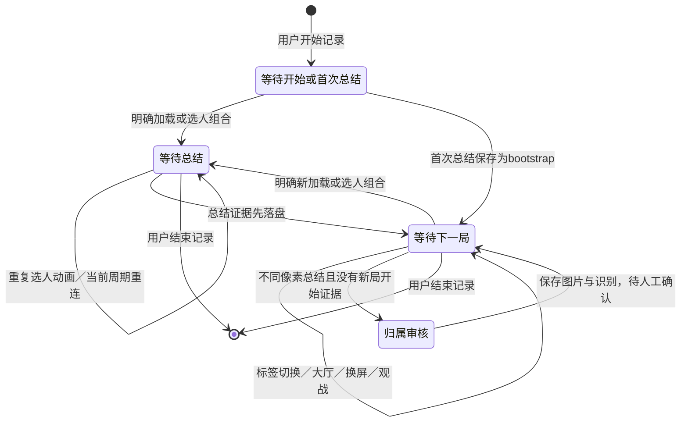

# v14 架构与数据流

本版本将“保存证据”“判断属于哪场比赛”“确认统计”分成三件事。页面不确定不等于截图作废，统计数字也不承担比赛身份的作用。程序仍然是本地 Windows 桌面应用：Tkinter 界面、Windows 公开画面捕获、RapidOCR CPU 推理、SQLite 持久化。没有录像编码、云端识别或游戏进程访问。

## 模块与职责

|模块|职责|不应承担的决策|
|---|---|---|
|`domain.py`|纯比赛周期、集中采样政策、待确认原因|窗口或SQLite调用|
|`windows.py`、`capture.py`|前台窗口公开元数据、显示器定位、物理像素截图|按伤害猜比赛|
|`automatic.py`|廉价总结模板候选及完整OCR页面校验|新局解锁状态机|
|`pages.py`|按文字位置组合识别加载／选人|名单与统计累计|
|`monitor.py`|采样、片段去抖、比赛周期调度|修改玩家数字|
|`journal.py`|截图写入恢复队列、提交后确认删除|把未提交的图悄悄丢弃|
|`ocr.py`|图片缩放、文字框、三张卡片与数字复核|判断两个相同数字是同局|
|`identity.py`、`session.py`|身份门槛、共同名单、可靠结果补算|猜缺字姓名|
|`matches.py`|比赛实体、OCR版本、审核记录、最终统计投影|Windows采样|
|`store.py`|存储门面、迁移、别名、证据合并、会话操作|捕获屏幕或运行模型|
|`services.py`|原图保存、OCR工作服务、发出结构化结果|直接操作Tk控件|
|`app.py`、`dpi.py`、`theme.py`|界面、任务执行器、主线程消费事件、DPI|重新实现识别与领域门槛|
|`media.py`、`candidates.py`|限定范围的照片清理、拒绝候选证据|清空用户选择的任意目录|

`store.py` 保留旧存储入口以兼容现有修正／历史功能；`app.py` 仍承担窗口与异步任务组合。这次不是把所有旧文件换名字，也不是完全重写每个模块；比赛周期、页面分类、身份规则、识别工作流、证据日志和比赛持久化已经独立，后续可继续拆解设置／审核界面的构建代码。

## 数据实体

- **Session**：一次开黑记录。人数1／2／3、开始结束时间、固定名单和会话昵称映射。
- **Match**：一次比赛，独立 `match_key`。可先由开始页建立 `open` 比赛，也可由中途启动首张总结建立 `bootstrap`；不确定归属进入审核。
- **Observation / Capture**：一张图片证据。包括原图路径、解码RGB＋尺寸哈希、来源、片段ID、比赛归属、OCR结果和副本关系。为兼容旧版，数据库表仍叫 `captures`。
- **OCRResult**：一份OCR版本。保留原始文字框／分数、卡片结果、识别版本和时间。重读产生新版本，不抹去旧结果。
- **Identity / Roster**：玩家槽位、完整显示名称、实际可见昵称别名、会话名单。数字页脚ID不用于比赛或玩家身份判断。
- **MatchStats**：已确认比赛的一份最终统计投影。主键为比赛＋玩家，不能对同一比赛追加第二份最终累计。
- **Review**：人工校正、忽略和比赛归属选择的依据。原图与旧统计证据保留；人工确认优先于后续自动结果。
- **LifecycleEvent**：新局开始证据与时间，供诊断回放；日志另记录页面分类、耗时和证据字段。

## 生命周期

“已保存总结”只关闭该比赛的开始识别周期，不阻止后续图片保存。**OCR完成与玩家名单确定不驱动新局周期**，因此低置信或单人名单等待不会挡住下一场。重复入场动画在未关闭周期内只识别一次，加载后进入选人也不会建立两场。

首次启动如果没看到开始页，允许接收首张总结。升级恢复旧锁时不会假称看到新局，后续总结走保图／审核路径。周期快照和最近32个像素哈希按会话保存；中途关闭重开可以恢复。活跃周期中的重连加载不建新局；已经保存总结后的重连若长得与新局完全相同，公开画面无法绝对区分，这是覆盖边界，见研究文档。

## 开始页的具体标准

所有参与判定的文字必须有OCR分数至少0.85；位置比例针对截图客户区，而非整个Windows桌面。

**选人**：至少4个独立职业标签精确命中（简／繁中文或英文）且位于高度62%以下；底部90%以下有当前选人／等待选人／选择英雄提示；顶部25%内有小队静音或取消选择等选人控制；明确靶场／英雄储物柜标题为负证据。标签的图案、英雄外观、地图和排位段位都不作为必要条件。1.0的规则分值仅表示组合成立，不能解释成100%准确率。

**加载／入场预览**：顶部有已列模式关键词，中央14%至43%高度有倒计时文字和中央横向35%至65%内的计时数字，底部有小队静音。不把任意加载插画当开始页；无需“世界尽头”“排位天梯”或钻石段位。没有这些组合的纯插画返回unknown，后续由选人页补充。

三块区域先将画面宽度限制为1800，再本地OCR：顶部左侧、下方选人带、中央计时区。每约2秒发起一次，最多一项等待结果，30秒过期；焦点／屏幕失效、进入总结会使旧探测结果失效。新局分类器不读取旧跳伞HUD、小队数或大厅罗盘。

## 采样、落盘与任务队列

1. 用户点击开始，Windows快捷键注册；按设置选择自动跟随游戏窗口或固定显示器。
2. 采样线程每0.5秒检查前台、窗口／屏幕，再捕获客户区。截图前后重新核对，移动竞态跳过重试。单张RGB画面超过32MB拒绝并显示状态。
3. 轻量模板在宽度1000的灰度图中检查总结标题及纵向对齐的伤害／击杀行。阈值：标题0.65，数字标签0.62；这只是候选定位，完整OCR仍重新校验中文总结文字布局。
4. 连续两个候选采样选较好图；只出现一次而立即离开页面也保留该帧。连续两个非总结采样结束“截图片段”，不等于新比赛。当前片段最多3张不同像素图，追加间隔8秒。
5. 先写 `capture-spool`：JSON写入意图→PNG写临时文件、flush＋fsync→原子改名；完整PNG必有会话／周期恢复上下文。之后才更新周期快照、派发OCR。
6. UI内存等待队列最多2项，超出转由磁盘恢复队列接续，页面OCR执行器与总结OCR执行器分开。没有一分钟视频或时间滑窗录制；临时图片日志不是录像。
7. 识别服务将原图存到用户选择的专用照片目录，执行OCR。UI主线程在事务中保存Capture和OCR版本；提交成功才删除spool。数据库处理失败保留spool，当前运行不无限重试同一失败项；重启后可以恢复。
8. 像素完全重复在OCR前查索引；数据库事务再次检查，防止并发插入。恢复队列遇到已提交像素复用原记录，不覆盖人工数据。

磁盘spool没有固定时间上限，故障时优先保住证据；处理速度长期低于采样速度可能积压，界面会提示队列繁忙。保留的图片、页面区域及模型会占用内存，但不随游戏时长累积录像内存。时间参数集中在 `domain.CapturePolicy`，改变阈值应带回放证据，不靠把时间锁越加越长。

## OCR与玩家标准

总结OCR检测文字框，根据固定标签和邻近几何位置分离每张卡片，再寻找昵称、伤害、击杀／助攻／击倒行。卡片位置只用于读取，玩家身份由可靠昵称与别名决定；名字换位不会改变统计对象。

必要数字置信度至少0.94，昵称至少0.85。伤害低置信可灰度／反色复读，仅高置信且一致采用；斜杠混入数字时按分隔符几何拆分复核。缺失字段是None，不自动填0。1人模式只要求目标玩家的数据，路人不影响数字确认；但新身份推断不能以未读出的路人当“消失”。

三人完整唯一昵称可以首局确定；单／双人需不同有效比赛的可靠共同集合恰好达到人数。若三人连续一起出现，双人仍有三位候选，继续等待或人工选择。可靠的既有绑定可辅助部分昵称缺失局。缺字方框只绑定实际读法，不能还原字；冲突别名与重名待人工确认。

## 三层重复判断

|问题|依据|结果|
|---|---|---|
|是否同一张图片|解码后的RGB像素＋尺寸SHA256，仅同Session|复用原Capture，少做OCR；压缩元数据无影响，JPEG像素变化不算精确重复|
|是否同一比赛的证据|明确开始周期的match_key，或人工归属审核；旧库只保留已证实分组|多张Capture收起副本，留下全部原图及OCR证据|
|累计哪份最终数据|人工修正优先，其次已确认，其次必要字段完整可靠的待确认图|每Match最多一份MatchStats|

**不会比较伤害、击杀、助攻是否相同来去重。** 同一比赛图像动画变化仍可属于同周期；不同比赛即使全员0伤害也各计一场。没有周期证据且图像不同，不猜同局，用户选择“新的一局”或“归入已有比赛”。收起的副本通过数据层仍可追溯，不是删除真实局。

统计场数来自已确认Match；总伤害／击杀／助攻来自MatchStats。场均=该玩家总伤害÷该会话已确认场数，待审核不进入分母。修正、忽略、恢复、归属调整都重新生成投影。照片删除不会删除最终统计，但删图后无法重新OCR。

## 迁移、恢复和维护边界

首次打开v14旧库先SQLite backup到 `backups/before-v14.sqlite3`。旧Capture为兼容证据保留，原图路径、OCR payload、手工stats不重写；有充分旧分组证据的副本沿用，否则各保留独立比赛。重复迁移稳定；迁移失败可关闭程序、恢复备份，原照片路径仍适用。不要运行旧版再打开已迁移库：旧版不理解MatchStats投影，新旧版混写未经支持。

本次私有备份迁移验证中，原Capture核心内容和所有stats逐行相等，quick_check及foreign_key_check通过。该结果验证迁移保存性，不能据此断言历史没有漏拍过比赛。

可测试的核心不依赖实际游戏：纯页面文字判定、MatchCycle、身份集合、像素摘要、SQLite事务、恢复日志。集成测试再覆盖真实模型、Tk界面、Windows截图、显示器元数据与DPI。没有真正观察到游戏新局→总结→下一局，就不能把合成回放写成完整实战验证。
