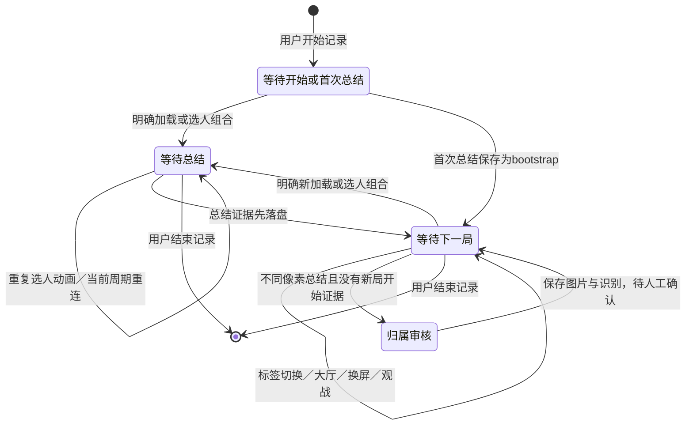

# v14 架构与数据流

## Beta 5 低置信数字整行复核

完整OCR先定位数据行，若三项可解析且原分值处于0.85–0.94，取该行可见文字bbox周围4像素、额外8像素边距的灰度图和反色图，在同一本地模型上仅识别文字。两次各只有一个结果、分值均在0.94–1.0且parse_triple三项全与原值相同才采用复核分值，原分值与两次分值继续保存在kills_assists_verification。它们是同一模型的两种呈现，不是两个独立模型投票，更不能推成准确率承诺。

整行不通过才继续既有前缀和橙色斜杠分字段兜底。门槛、昵称绑定、比赛周期和去重均不改变；数字相同仍不代表同一局。v7只主动升级v6待确认，保持旧的v6以前迁移复读行为，已确认v6避免无意义后台推理。update_recognition显式保留game_mode及人工审核元数据，最终stats仍以人工确认优先。

例外是出现高置信、可解析但与原值冲突的整行复读：记录whole-triple-conflict及观察值，原分值保持不变，并停止其后的数字兜底，进入审核。这样不会通过多次尝试挑选一个符合预期的读数来绕过冲突；低分、空读或不可解析只算缺少复核证据，不伪造数字。

## Beta 4 捕获边框偏好

设置hide_capture_border默认true，传入SummaryWatcher再传GraphicsWindowSource，仅设置当前捕获session的draw_border=False；取消偏好使用None恢复系统默认。它是窗口捕获配置，不改变页面分类、比赛身份和累计规则；切换开关时沿用持久化phase重建采样。界面文字说明系统可能保留边框，不把设置值当作实际显示结果。

明确border不支持错误先只恢复draw_border=None，保留cursor/secondary/interval；其他可选属性不支持再全部使用None，最多三次初始化。任意普通捕获错误不会无限重试或改抓其他程序；原先重试节流和暂停提示保留。只表达官方API偏好，不修改DWM、注册表、权限状态或游戏，也不自动点击系统授权。是否显示由Windows版本/权限以及其他捕获会话共同决定。

## Beta 3 外卡分支与模式字段

外卡加载布局不依赖底部静音，改为左上模式＋中央14%–43%倒计时／数字＋中央45%–68%玩法说明。外卡同时选人不依赖底部轮流提示，要求左上模式＋下方至少四职业＋左侧25%–55%选择传奇＋同区域独立小队静音／自愿跳伞控制。职业、模式卡片或单个控制词不能单独开启比赛。明确大厅导航、储物柜、靶场、重新连接是负证据；OCR分值门槛仍0.85，规则分值1.0只代表组合成立。

沿用MatchCycle，不另加按数字判断的锁。入场profile标记wildcard后传入周期game_mode，再随总结context进入MatchRepository；重复加载→选人仍是同一match_key。SQLite matches.game_mode（schema15）和持久cycle均保存模式；UI历史最后一列显示外卡。未知默认不显示标签，不等于已验证普通模式；旧数据库升级自动一致备份，不从娱乐高伤害、重生次数或当前大厅模式回填。模式不影响名单、去重、累计或场均，也不等于Session.mode统计人数。

本版本将“保存证据”“判断属于哪场比赛”“确认统计”分成三件事。页面不确定不等于截图作废，统计数字也不承担比赛身份的作用。程序仍然是本地 Windows 桌面应用：Tkinter 界面、Windows 公开画面捕获、RapidOCR CPU 推理、SQLite 持久化。没有录像编码、云端识别或游戏进程访问。

## 模块与职责

|模块|职责|不应承担的决策|
|---|---|---|
|`domain.py`|纯比赛周期、集中采样政策、待确认原因|窗口或SQLite调用|
|`windows.py`、`capture.py`、`window_capture.py`|公开窗口元数据、WGC单窗口帧、兼容屏幕截图|按伤害猜比赛|
|`automatic.py`|廉价总结模板候选及完整OCR页面校验|新局解锁状态机|
|`pages.py`|按文字位置组合识别加载／选人|名单与统计累计|
|`monitor.py`|采样、片段去抖、比赛周期调度|修改玩家数字|
|`journal.py`|截图写入恢复队列、提交后确认删除|把未提交的图悄悄丢弃|
|`ocr.py`|图片缩放、文字框、三张卡片与数字复核|判断两个相同数字是同局|
|`identity.py`、`session.py`|身份门槛、共同名单、可靠结果补算|猜缺字姓名|
|`matches.py`|比赛实体、OCR版本、审核记录、最终统计投影|Windows采样|
|`store.py`|存储门面、迁移、别名、证据合并、会话操作|捕获屏幕或运行模型|
|`services.py`|原图保存、OCR工作服务、发出结构化结果|直接操作Tk控件|
|`app.py`、`dpi.py`、`theme.py`|界面、任务执行器、主线程消费事件、DPI|重新实现识别与领域门槛|
|`media.py`、`candidates.py`|限定范围的照片清理、拒绝候选证据|清空用户选择的任意目录|

`store.py` 保留旧存储入口以兼容现有修正／历史功能；`app.py` 仍承担窗口与异步任务组合。这次不是把所有旧文件换名字，也不是完全重写每个模块；比赛周期、页面分类、身份规则、识别工作流、证据日志和比赛持久化已经独立，后续可继续拆解设置／审核界面的构建代码。

## 数据实体

- **Session**：一次开黑记录。人数1／2／3、开始结束时间、固定名单和会话昵称映射。
- **Match**：一次比赛，独立 `match_key`。可先由开始页建立 `open` 比赛，也可由中途启动首张总结建立 `bootstrap`；不确定归属进入审核。
- **Observation / Capture**：一张图片证据。包括原图路径、解码RGB＋尺寸哈希、来源、片段ID、比赛归属、OCR结果和副本关系。为兼容旧版，数据库表仍叫 `captures`。
- **OCRResult**：一份OCR版本。保留原始文字框／分数、卡片结果、识别版本和时间。重读产生新版本，不抹去旧结果。
- **Identity / Roster**：玩家槽位、完整显示名称、实际可见昵称别名、会话名单。数字页脚ID不用于比赛或玩家身份判断。
- **MatchStats**：已确认比赛的一份最终统计投影。主键为比赛＋玩家，不能对同一比赛追加第二份最终累计。
- **Review**：人工校正、忽略和比赛归属选择的依据。原图与旧统计证据保留；人工确认优先于后续自动结果。
- **LifecycleEvent**：新局开始证据与时间，供诊断回放；日志另记录页面分类、耗时和证据字段。

## 生命周期

“已保存候选”暂时关闭周期且阻止重复创建，完整OCR通过后确认关闭；OCR拒绝且没有成功结果时回滚。“已保存总结”只关闭该比赛的开始识别周期，不阻止后续图片保存。**OCR完成与玩家名单确定不驱动新局周期**，因此低置信或单人名单等待不会挡住下一场。重复入场动画在未关闭周期内只识别一次，加载后进入选人也不会建立两场。

首次启动如果没看到开始页，允许接收首张总结。升级恢复旧锁时不会假称看到新局，后续总结走保图／审核路径。周期快照和最近32个像素哈希按会话保存；中途关闭重开可以恢复。活跃周期中的重连加载不建新局；已经保存总结后的重连若长得与新局完全相同，公开画面无法绝对区分，这是覆盖边界，见研究文档。

## 开始页的具体标准

所有参与判定的文字必须有OCR分数至少0.85；位置比例针对截图客户区，而非整个Windows桌面。

**选人**：至少4个独立职业标签精确命中（简／繁中文或英文）且位于高度62%以下；底部90%以下有当前选人／等待选人／选择英雄提示；横向左48%、高度52%内有小队静音或取消选择等选人控制；明确靶场／英雄储物柜标题为负证据。标签的图案、英雄外观、地图和排位段位都不作为必要条件。1.0的规则分值仅表示组合成立，不能解释成100%准确率。

**加载／入场预览**：顶部有已列模式关键词，中央14%至43%高度有倒计时文字和中央横向35%至65%内的计时数字，底部有小队静音。不把任意加载插画当开始页；无需“世界尽头”“排位天梯”或钻石段位。没有这些组合的纯插画返回unknown，后续由选人页补充。

四块区域先将画面宽度限制为1800，再本地OCR：左侧上半部、下方选人带、中央入场区域、顶部罗盘带。每约2秒尝试发起，最多一项等待结果，30秒过期。模板候选不能阻塞入场探测。

备用初始运输船要求中央跳伞指挥官文字、单独发射控制、标记复制器／船上玩家提示以及至少三个方向罗盘词共同出现；观战、死亡回放、靶场、重生文字为负证据。至少两次探测间隔2秒且不超过30秒；普通战斗HUD不建立比赛，尚未结束的周期忽略重连／重选。该规则未验证所有娱乐模式。

## 采样、落盘与任务队列

1. 用户点击开始，Windows快捷键注册；按设置选择自动跟随游戏窗口或固定显示器。
2. 采样线程每0.5秒读取绑定的 Apex HWND 窗口客户区。WGC更新间隔请求250ms，内存仅保留一张最新帧；复制前BGRA尺寸限制32MiB，最后帧超过3秒或最小化时暂停，窗口尺寸过渡跳过。兼容模式仍截图前后核对前台与屏幕。
3. 轻量模板在宽度1000的灰度图中检查总结标题及纵向对齐的伤害／击杀行。阈值：标题0.65，数字标签0.62；这只是候选定位，完整OCR仍重新校验中文总结文字布局。
4. 连续两个候选采样选较好图；只出现一次而立即离开页面也保留该帧。连续两个非总结采样结束“截图片段”，不等于新比赛。当前片段最多3张不同像素图，追加间隔8秒。
5. 先写 `capture-spool`：JSON写入意图→PNG写临时文件、flush＋fsync→原子改名；完整PNG必有会话／周期恢复上下文。之后才更新周期快照、派发OCR。
6. UI内存等待队列最多2项，超出转由磁盘恢复队列接续，页面OCR执行器与总结OCR执行器分开。没有一分钟视频或时间滑窗录制；临时图片日志不是录像。
7. 识别服务将原图存到用户选择的专用照片目录，执行OCR。UI主线程在事务中保存Capture和OCR版本；提交成功才删除spool。数据库处理失败保留spool，当前运行不无限重试同一失败项；重启后可以恢复。
8. 像素完全重复在OCR前查索引；数据库事务再次检查，防止并发插入。恢复队列遇到已提交像素复用原记录，不覆盖人工数据。

磁盘spool没有固定时间上限，故障时优先保住证据；处理速度长期低于采样速度可能积压，界面会提示队列繁忙。保留的图片、页面区域及模型会占用内存，但不随游戏时长累积录像内存。时间参数集中在 `domain.CapturePolicy`，改变阈值应带回放证据，不靠把时间锁越加越长。

## OCR与玩家标准

总结OCR检测文字框，根据固定标签和邻近几何位置分离每张卡片，再寻找昵称、伤害、击杀／助攻／击倒行。卡片位置只用于读取，玩家身份由可靠昵称与别名决定；名字换位不会改变统计对象。

必要数字置信度至少0.94，昵称至少0.85。伤害低置信可灰度／反色复读，仅高置信且一致采用；斜杠混入数字时按分隔符几何拆分复核。缺失字段是None，不自动填0。1人模式只要求目标玩家的数据，路人不影响数字确认；但新身份推断不能以未读出的路人当“消失”。

三人完整唯一昵称可以首局确定；单／双人需不同有效比赛的可靠共同集合恰好达到人数。若三人连续一起出现，双人仍有三位候选，继续等待或人工选择。可靠的既有绑定可辅助部分昵称缺失局。缺字方框只绑定实际读法，不能还原字；冲突别名与重名待人工确认。

## 三层重复判断

|问题|依据|结果|
|---|---|---|
|是否同一张图片|解码后的RGB像素＋尺寸SHA256，仅同Session|复用原Capture，少做OCR；压缩元数据无影响，JPEG像素变化不算精确重复|
|是否同一比赛的证据|明确开始周期的match_key，或人工归属审核；旧库只保留已证实分组|多张Capture收起副本，留下全部原图及OCR证据|
|累计哪份最终数据|人工修正优先，其次已确认，其次必要字段完整可靠的待确认图|每Match最多一份MatchStats|

**不会比较伤害、击杀、助攻是否相同来去重。** 同一比赛图像动画变化仍可属于同周期；不同比赛即使全员0伤害也各计一场。没有周期证据且图像不同，不猜同局，用户选择“新的一局”或“归入已有比赛”。收起的副本通过数据层仍可追溯，不是删除真实局。

统计场数来自已确认Match；总伤害／击杀／助攻来自MatchStats。场均=该玩家总伤害÷该会话已确认场数，待审核不进入分母。修正、忽略、恢复、归属调整都重新生成投影。照片删除不会删除最终统计，但删图后无法重新OCR。

## 迁移、恢复和维护边界

首次打开v14旧库先SQLite backup到 `backups/before-v14.sqlite3`。旧Capture为兼容证据保留，原图路径、OCR payload、手工stats不重写；有充分旧分组证据的副本沿用，否则各保留独立比赛。重复迁移稳定；迁移失败可关闭程序、恢复备份，原照片路径仍适用。不要运行旧版再打开已迁移库：旧版不理解MatchStats投影，新旧版混写未经支持。

本次私有备份迁移验证中，原Capture核心内容和所有stats逐行相等，quick_check及foreign_key_check通过。该结果验证迁移保存性，不能据此断言历史没有漏拍过比赛。

可测试的核心不依赖实际游戏：纯页面文字判定、MatchCycle、身份集合、像素摘要、SQLite事务、恢复日志。集成测试再覆盖真实模型、Tk界面、Windows截图、显示器元数据与DPI。没有真正观察到游戏新局→总结→下一局，就不能把合成回放写成完整实战验证。

## Beta 2 连续性与人工审核同步

模板失败或画面暂时缺失保留同一个episode至12秒；明确入场证据立即切换周期。超过窗口仍未知则另存待审核证据，不能据时间推断历史归属。每片段仍最多3张不同像素图，间隔8秒。精确截图去重仍只使用尺寸及RGB像素；Beta6补充下述独立视觉归属证据，片段归属与截图去重是两层规则。

一次人工assign_match覆盖同会话、同episode的自动证据，包括后续入库图片；显式冲突审核和keep_separate不覆盖。启动／协调时对已有同片段审核作可重复恢复，不按相同伤害或相邻时间合并旧片段。原始OCR版本、原图、手工stats保持可查。

## Beta6：总结返回与参团率

`summary_surface.surface_evidence`是独立、保守的同页视觉证据，并不更改`image_digest`。比较同尺寸原图，按OCR伤害标签位置确定三个完整数据条，包含昵称、击杀助攻击倒、伤害、生存时间、急救、重生等画面内容，所有明亮像素通道差不超过20；另要求至少两块高变化量卡面99%以上像素通道差不超过20。没有三卡、不支持的分辨率、缺图、文本变化或卡面变化则不通过。右上排队框、世界背景、字幕不在这些区域。此处是容差视觉比对，不能称为整图像素完全一致。

Store按观测顺序只尝试前一个已归属总结到紧随其后的未归属自动截图。明确新周期、期间的持久`match_started`事件、不同总结、明确的新比赛人工作业／仍在忽略状态和120秒拒绝窗口构成边界，不搜索更早历史里的相同数字。通过后记录`visual_return`及reviews依据，将观测归回已有比赛，再由既有canonical规则收起副本。完整原图、原始OCR版本、人工stats均保留；重启重复整理稳定。无法观察到的开始页与完全相同的总结，仍存在画面方法本身的歧义。

`participation.squad_kills`只解读定位在数据卡上方的小队总击杀标签及右邻高置信整数；若头部未出现，可从全部三卡高置信击杀求和。只看到一／二卡、矛盾头部、多值矛盾均不能替代为选中玩家之和。MatchRepository在schema16维护`team_kills`、来源、人工覆盖值及覆盖标志；每次sync从canonical及其已证实副本归纳分母，冲突留空，人工作业优先。旧OCR的lines/cards也走相同规则，不篡改原OCR。

个人MatchStats仍独立。总参团率为confirmed比赛个人Σ(kills+assists)/Σ(team_kills)；只要任一有效比赛分母未知，整体显示未知并给出缺失局数，而不是偷偷排除该比赛。完整零分母显示—，不截断超过100%的按公式结果。Review可独立修正或恢复自动分母；事件和SQLite事务保留依据。

## Beta7：只读明确总击杀与加载就绪

本节取代Beta6的三卡分母兜底。participation.squad_kills仅解析明确的“小队总击杀”标签与同列邻接高置信数字，或标签和数字合并行；不对个人击杀做求和／一致性校验。单局(personal kills+assists)/displayed squad kills；累计Σ(personal kills+assists)/Σ(displayed squad kills)。未读出／头部多值矛盾为空，不把缺失当0；合法0分母保留，百分比显示—。

SummaryDetector除原总结模板，还在归一化1000像素画面右上横条匹配纯“小队总击杀”短标签，并检查其右侧黄色数字字形；不使用排队框、昵称或特定数字模板。SummaryReadiness要求总结可见至少1.5秒、标签与数字连续稳定至少1秒（前景掩码差异≤1.5%）；才选完整帧并写入原有耐久队列，之后完整OCR仍须读到标签数值。颜色／布局不匹配时保守等待，不从个人卡片推断。当前验证中文16:9与16:10。阈值集中在domain.CapturePolicy。

等待阶段只保留一张最新候选图片内存，不提前锁定／计入。正常离开或停止时救存最多一张incomplete候选；该候选不自动确认，并为加载完成后的三次完整候选留出机会。同一比赛的complete候选优先参与最终头部分母归纳；人工覆盖优先。相同RGB后来通过稳定检查，可按同match_key／episode_key升级readiness并记审核，不伪造新OCR版本，不重复计数。场数／身份／去重仍独立，不按数据相同归并比赛。

schema17一致备份后清除所有非人工three-complete-cards缓存，再从不可变旧OCR lines重算明确头部；既有confirmed个人stats不撤销，缺分母的累计百分比为未知。新真实识别与既有真实captured pending需明确分母才自动确认；unversioned旧导入保留其人工工作流。公共短词模板仅含UI标签字形，不包含用户昵称、账号、整图或角色装饰。

## Beta8：明确总击杀的定向复读

OCRv10以高置信、总结头部右侧的小队总击杀完整标签定位数字范围，从原色与黄色字形两种视图分别做灰度／反色复读，四次高置信一致后记录squad_kills_verification，包含区域、值、最小分值与算法版本。参与分母归纳；与原始高置信头部冲突时不覆盖，继续审核。原lines保留，三张卡片不用于推断分母。

采样侧仍需完整总结布局。标签以相同0.70门槛及受限位置在多亮度下匹配；数字mask固定稳定段起点作为参考，允许8%边缘像素差，超出重置计时。连续可见1.5秒、数字稳定1秒要求保留，离屏重置。OCR成功不等同于自动补造旧时序证明；旧incomplete保持待核对。异常救存日志包含具体gate_reason，帮助后续区分标签不可见、数字不可见和稳定等待。无需数据库迁移，人工stats及分母覆盖优先。
